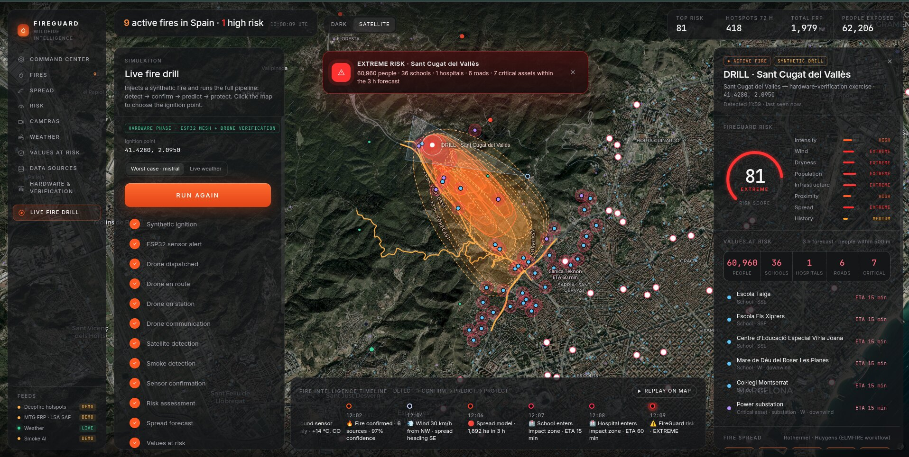
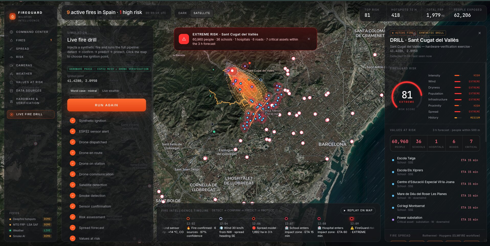
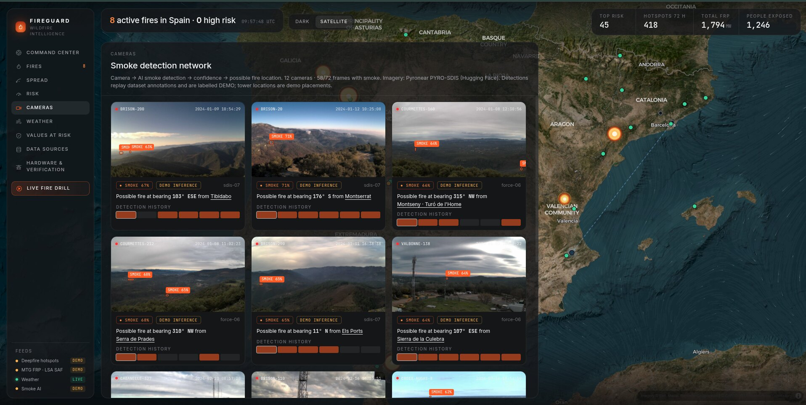
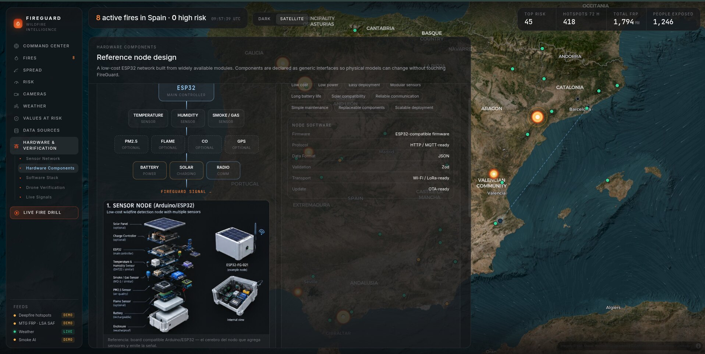
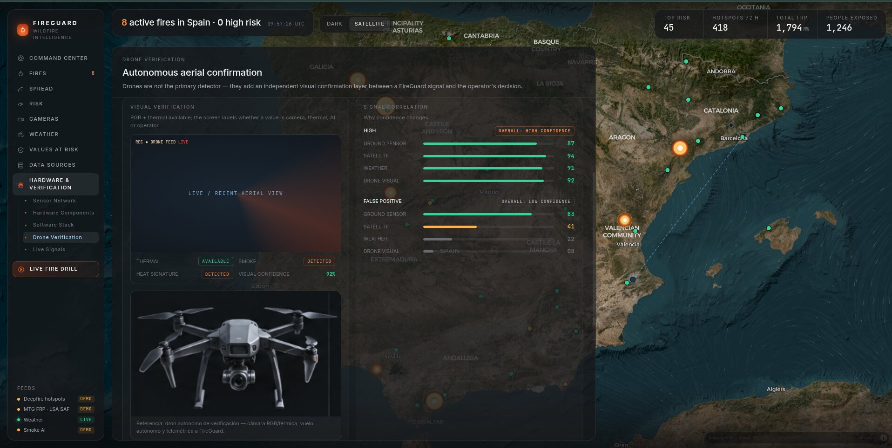
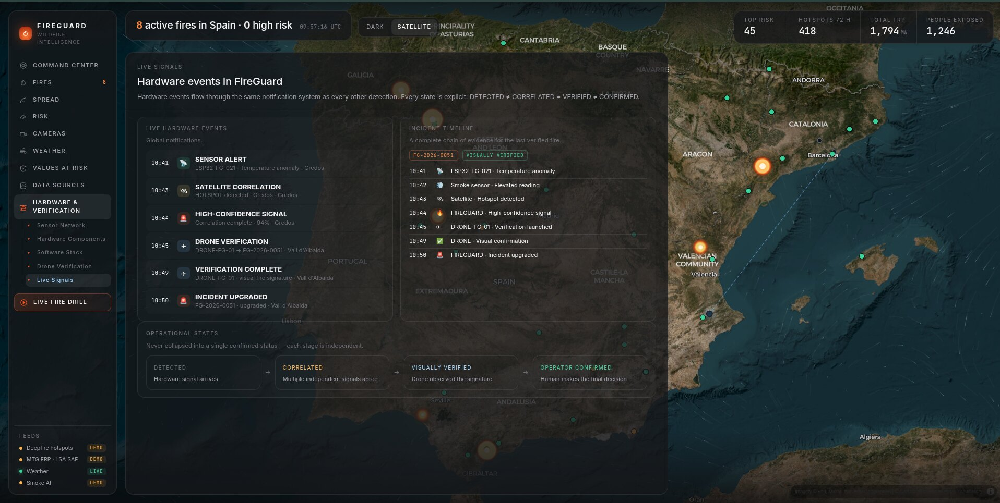
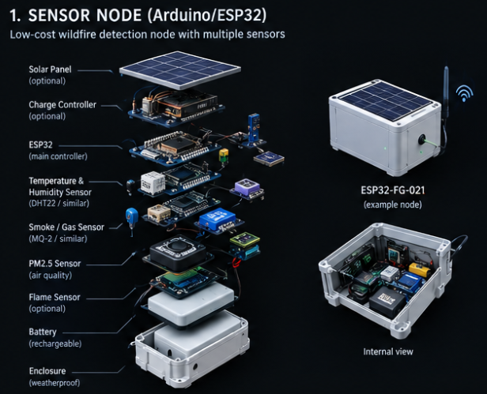
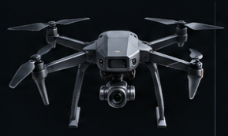

<div align="center">

# 🔥 FireGuard

### Wildfire Intelligence for Spain
**DETECT → CONFIRM → PREDICT → PROTECT**




</div>

> [!IMPORTANT]
> **This is a DEMO of a real, working software project.** It shows how FireGuard
> would operate when deployed: it is built on real data APIs (satellite hotspots,
> geostationary fire radiative power, live weather, OpenStreetMap, official
> Catalan fire records) and a camera → AI smoke-detection pipeline.
> Parts of the scenario are **deliberately simulated and labelled `DEMO` / `SYNTHETIC`
> on screen** — see [What is real vs. simulated](#-what-is-real-vs-simulated).
>
> **This repository is a public excerpt, not the full product.** Credentials,
> private infrastructure and the proprietary models were deliberately excluded —
> see [Intellectual property](#-intellectual-property).

---

## 📌 Overview

FireGuard is a wildfire command center. It fuses several independent signals on a
single map to tell an operator **where a fire is, whether it is real, where it is
going, and who is in its path**:

| Stage | Question | What FireGuard does |
|---|---|---|
| **Detect** | Is something burning? | Satellite hotspots, MTG fire radiative power, AI smoke detection on tower cameras, ESP32 ground sensors |
| **Confirm** | Is it real? | Cross-correlates independent signals; a drone adds visual confirmation; a human makes the final call |
| **Predict** | Where will it go? | Wind-driven spread forecast at +15 min, +30 min, +1 h and +3 h |
| **Protect** | Who is at risk? | Population, schools, hospitals, roads and critical infrastructure with ETA to impact, plus a 0–100 risk score |

## 🎬 Demo

- **Live website demo:** https://fireguard.alexutils.uk/
- Open **LIVE FIRE DRILL**, click anywhere on the map to choose an ignition point and press start. The drill runs the complete pipeline end-to-end:
  *synthetic ignition → ESP32 sensor alert → drone dispatched → satellite detection → smoke detection → sensor confirmation → risk assessment → spread forecast → values at risk → alert.*

## 🖼️ Screenshots

### Live fire drill — detect → confirm → predict → protect


Spread forecast (observed / modelled / forecast perimeters), population and asset
exposure with ETA, risk score 0–100 broken down into eight factors, and an
event timeline that can be replayed on the map.

### Smoke detection network


Tower cameras → AI smoke detection → confidence → estimated fire bearing and
location. Imagery comes from the open [Pyronear PYRO-SDIS](https://huggingface.co/datasets/pyronear/pyro-sdis) dataset.

### Hardware & verification
<table>
<tr>
<td width="50%"><br><sub><b>Reference node design</b> — low-cost, modular ESP32 sensor node.</sub></td>
<td width="50%"><br><sub><b>Drone verification</b> — independent visual confirmation and confidence correlation.</sub></td>
</tr>
</table>



Every state is explicit and never collapsed: **DETECTED ≠ CORRELATED ≠ VERIFIED ≠ CONFIRMED.**

<table>
<tr>
<td align="center" width="50%"><br><sub>ESP32 sensor node (exploded view)</sub></td>
<td align="center" width="50%"><br><sub>RGB + thermal verification drone</sub></td>
</tr>
</table>

## ⚙️ How it works

1. **Ingest** — the API gateway pulls hotspots, MTG FRP pixels and weather, and caches heavy sources.
2. **Cluster** — hotspots are grouped into discrete fires with intensity (FRP) and history.
3. **Confirm** — satellite, smoke-camera, ground-sensor, weather and drone signals are correlated; each stage keeps its own state.
4. **Model** — a wind-driven spread model (Rothermel → Anderson ellipse → Huygens front) is run on hourly forecast wind.
5. **Assess** — assets inside or near each forecast perimeter get an ETA; people are counted on a grid; a weighted risk score is produced.
6. **Alert** — the operator sees one prioritised view and decides.

## 🏗️ Architecture

```mermaid
flowchart LR
  subgraph Sources
    A[Deepfire hotspots]:::s
    B[LSA SAF MTG FRP]:::s
    C[Open-Meteo weather]:::s
    D[Tower cameras + AI smoke]:::s
    E[ESP32 ground sensors]:::s
    F[Drone RGB/thermal]:::s
    G[OSM · Gencat]:::s
  end
  Sources --> API[Node/Express API gateway<br/>auth · cache · fallback to demo data]
  API --> WEB[React + MapLibre command center]
  WEB --> ENG[Analysis engine<br/>spread · exposure · risk]:::p
  ENG --> OUT[Operator alert + timeline]
  classDef s fill:#1f2937,stroke:#f97316,color:#fff;
  classDef p fill:#7f1d1d,stroke:#ef4444,color:#fff,stroke-dasharray: 4 3;
```



<sub>Dashed red = proprietary component, **not included** in this repository.</sub>

### Repository layout (public excerpt)

```
server/     API gateway: Deepfire + LSA SAF adapters, weather/OSM proxy, synthetic demo data
scripts/    Data-preparation scripts (OSM, roads, Gencat, Pyronear frames)
web/src/
  components/   UI building blocks (shell, gauge, timeline, panels, charts)
  lib/          types, geo helpers, state store, detection-network model
                spread.ts / analysis.ts / hardware.ts → documented STUBS
  map/          wind-field canvas layer
  pages/        Cameras and Data-sources pages
docs/images/    Screenshots and hardware reference images
```

## 🧰 Technologies

**Frontend:** React 19 · TypeScript · Vite · MapLibre GL · Turf.js · Framer Motion
**Backend:** Node.js · Express · dotenv
**Data prep:** Python (pyshp, pyproj, shapely)
**Hardware reference:** ESP32 (HTTP/MQTT-ready, Wi-Fi/LoRa, OTA), DHT22, MQ-2, PM2.5, flame sensor, solar + battery
**Science:** Rothermel (1972) · Anderson (1983) · Simard (1968) · Richards (1990) · Scott & Burgan (2005)

### Data sources

| Layer | Source |
|---|---|
| Hotspots | Deepfire Hotspots API (OGC Features) |
| Fire radiative power | LSA SAF MTG MTFRPPixel |
| Smoke imagery | Pyronear PYRO-SDIS (Hugging Face) |
| Weather | Open-Meteo |
| Catalan fire history | Gencat Interior (perimeters, danger zones) |
| Values at risk | OpenStreetMap |

## ✅ What is real vs. simulated

| Component | Status in this demo |
|---|---|
| Weather and wind field | **Live** (Open-Meteo) |
| Satellite hotspots / MTG FRP | Real APIs, **enabled with credentials**; otherwise a labelled `DEMO` scenario |
| Smoke detection | Replays annotations from a real public dataset, labelled **`DEMO INFERENCE`** |
| Tower and ground-sensor positions | **Demo placements** |
| ESP32 nodes and drone | Reference design + **simulated** telemetry in the drill |
| Fire drill | **Synthetic** ignition, always labelled |

## 🔒 Security & privacy

This public version contains **no**:

- API keys, tokens, passwords or client secrets (only an empty `.env.example`).
- Private URLs, RTSP streams, IP addresses or real camera access.
- Internal infrastructure or deployment configuration.
- Personal or sensitive data.

Secrets are read from server-side environment variables only. See [SECURITY.md](SECURITY.md).

## ⚖️ Intellectual property

The proprietary parts of FireGuard were **deliberately excluded** from this repository:
the fire-spread engine and its calibration, the risk-scoring weights, the exposure
and ETA computation, the drill orchestration, the map/analysis integration, the
hardware firmware, and all credentials and infrastructure.

What remains is a non-strategic excerpt (API adapters, UI components, data-prep
scripts, types, and documented stubs) that demonstrates the project was genuinely
built, without exposing the full implementation. **This excerpt is not runnable on
its own.** See [LICENSE](LICENSE) — all rights reserved.

## ⚠️ Disclaimer

FireGuard is a demonstration and is **not** a certified emergency-response system.
Do not use it for real safety decisions.
